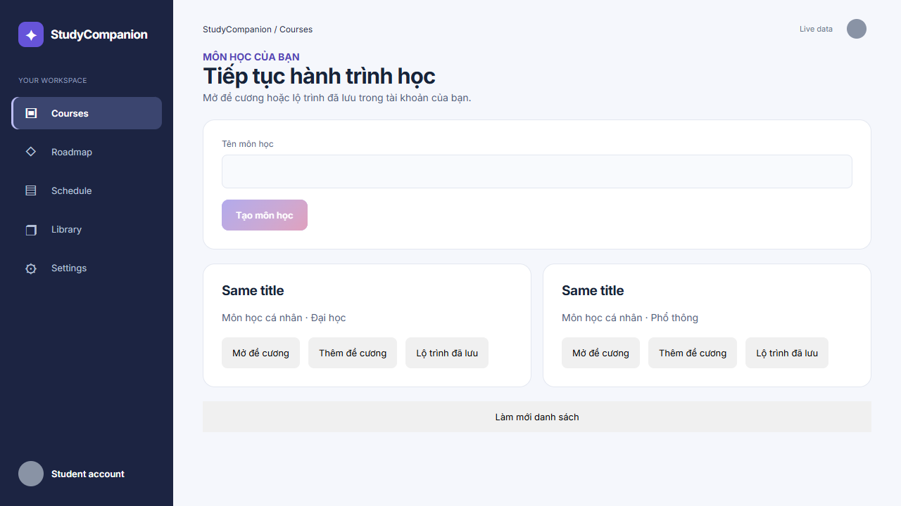
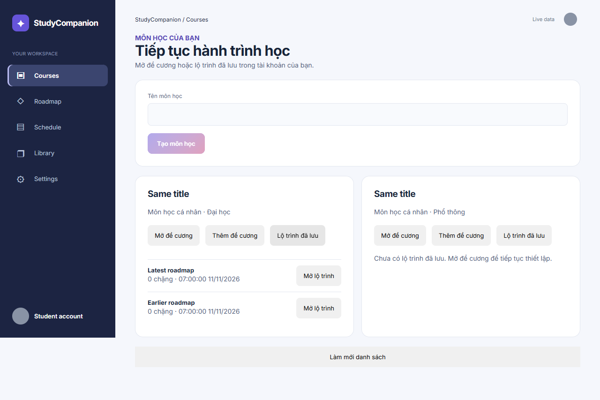
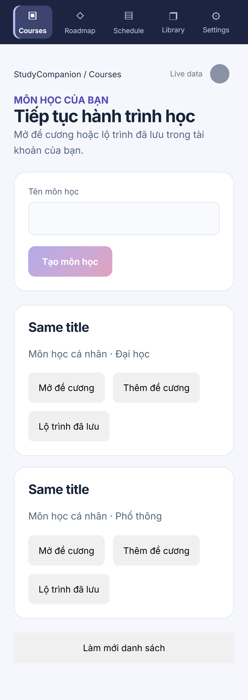

# Personal course selection and saved-roadmap recovery

Local follow-up to PR #153; kept on a separate branch while that PR is reviewed.

## Behavior

- Courses reads the authenticated account's `/courses`; it is not a prepared Library catalog.
- Create a course with the existing title rules (trimmed, 1–200 characters). No course is created merely by opening Courses.
- Open a saved syllabus with the existing review UI, or add a new syllabus to the selected course.
- Expand a course to discover all its saved roadmaps, newest first; choose a specific version to reopen the existing graph/timeline screen.
- Course selection and opened roadmap IDs are carried in the URL. Reload reads backend records rather than treating browser storage as production persistence.
- Materials, syllabus parsing, confirmation and generation use the selected course ID. Identical titles do not merge different courses.
- Loading, empty, failure and retry states are visible. Existing responsive controls, theme tokens and dialogs are reused.

## Integration

`GET /api/v1/courses/{course_id}/roadmaps` is a read-only addition in `routes_core.py`, reusing `RoadmapOut` and existing serialization. It checks course ownership and filters roadmap ownership. No migration, deletion, enrollment policy or new dependency.

Restart a development backend that was launched without `--reload` before testing this endpoint. Existing graph bookmarks continue to work.

## Verification

- Pytest covers list ordering, multiple saved versions, empty courses, reload-equivalent reads, missing courses, unauthenticated access and cross-account denial.
- Playwright API fixtures cover recovery, retries, duplicate titles, course creation, roadmap reopening/reload, responsive layout and axe accessibility; existing syllabus/materials tests now select courses explicitly.
- Browser fixtures are deterministic API-contract tests, not evidence of live-server persistence. Backend tests use isolated databases.

## Remaining scope

This does not introduce prepared-course enrollment, tutorial initialization, course deletion or saved-source Library functionality. Backend roadmap payloads do not expose learner completion status, so course cards do not invent a progress percentage. The root graph still displays the currently opened roadmap, not a combined graph of every account course. Unsaved syllabus changes remain in component state; only confirmed syllabus data and generated roadmaps can be recovered from the backend.

## Try it locally

Use the API-mode startup instructions in `ui/README.md`. Sign in, open **Courses**, expand **Lộ trình đã lưu** on an existing course and choose **Mở lộ trình**. Use **Mở đề cương** to resume its saved review or **Thêm đề cương** to begin a new upload for that course. **Đổi môn học** reopens the account course picker.

The browser screenshot fixtures intentionally use two courses with the same title to verify that course IDs, not names, determine which data opens.

## Local verification results

- `python dev.py devops ci`: passed, including 720 backend tests, Ruff, secret scanning and benchmark fixture validation.
- Vitest: 202 tests passed across 36 files.
- Production TypeScript/Vite build: passed after the browser-history fix.
- Full Playwright suite: 56 passed, 6 expected skips. After adding browser-history synchronization, the course/graph suites passed again: 28 passed, 6 expected skips, including both new Back-navigation cases.
- Course picker axe checks: no violations in light/dark mode; mobile layout verified at 360px without horizontal overflow.

Screenshots below use API-contract fixtures, not a live learner account. The two same-title courses intentionally test separate identities.

