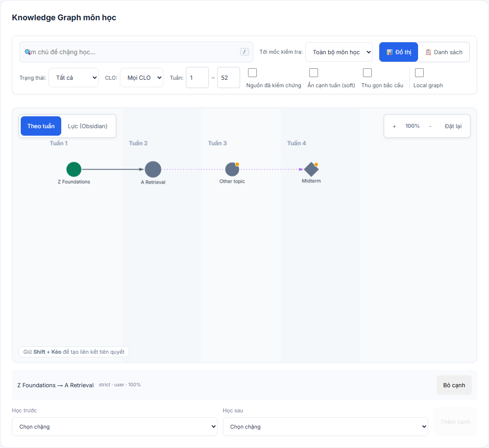
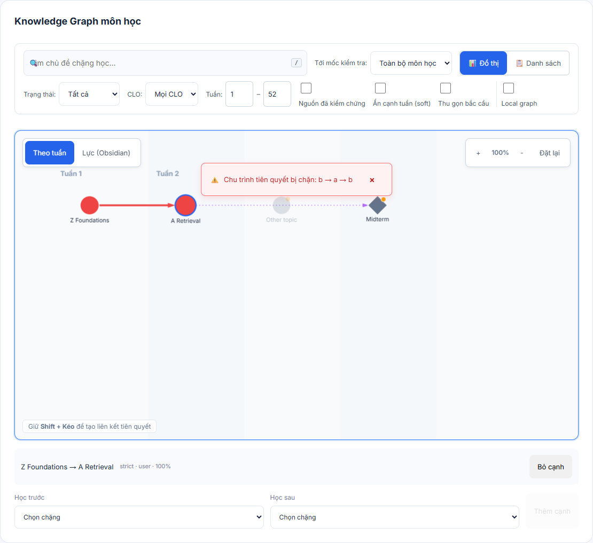
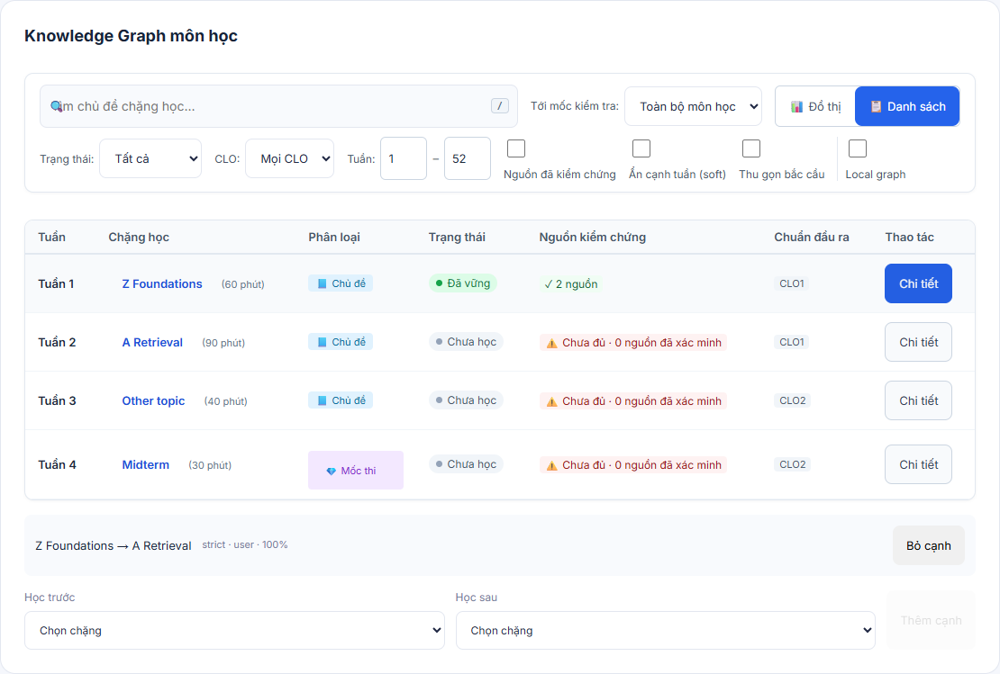
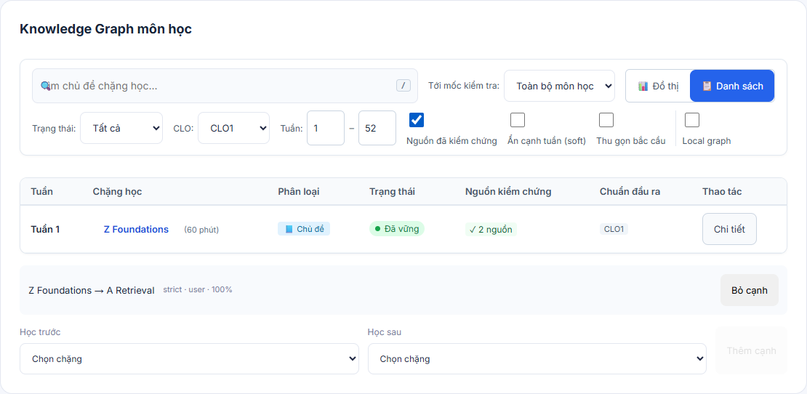
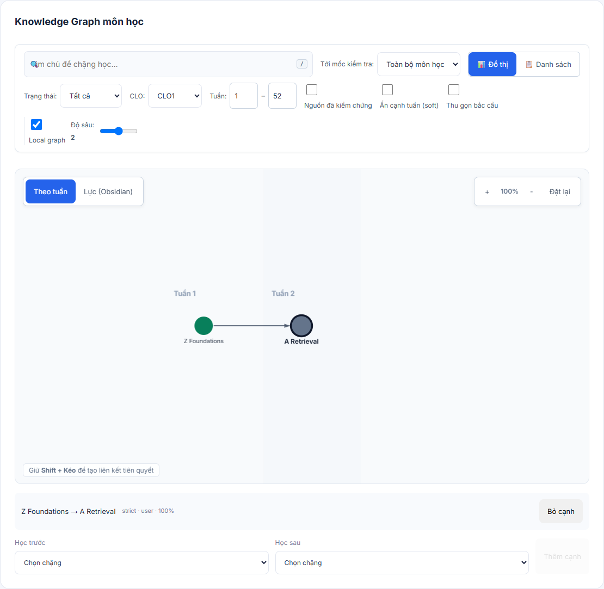
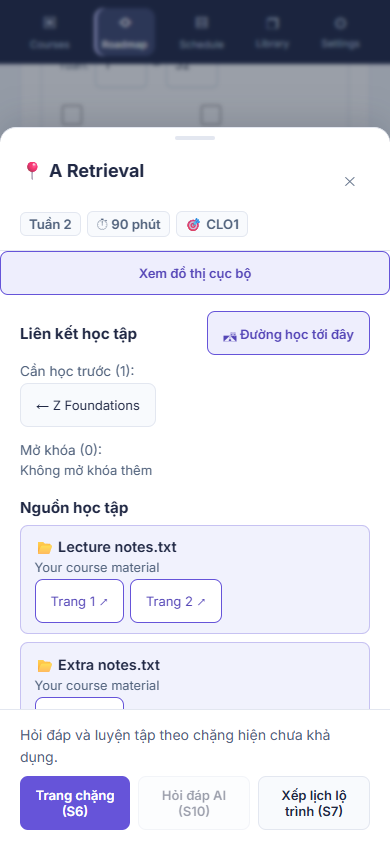
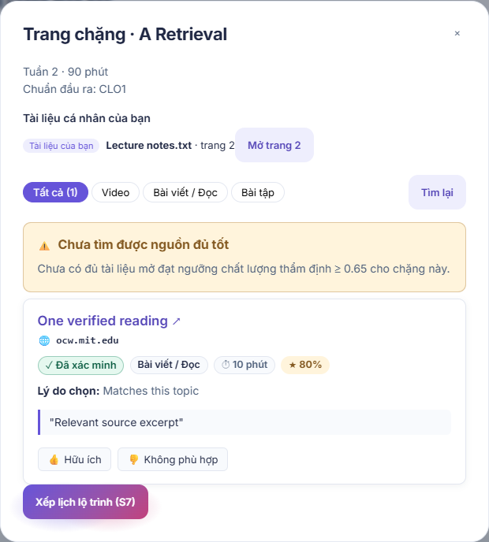
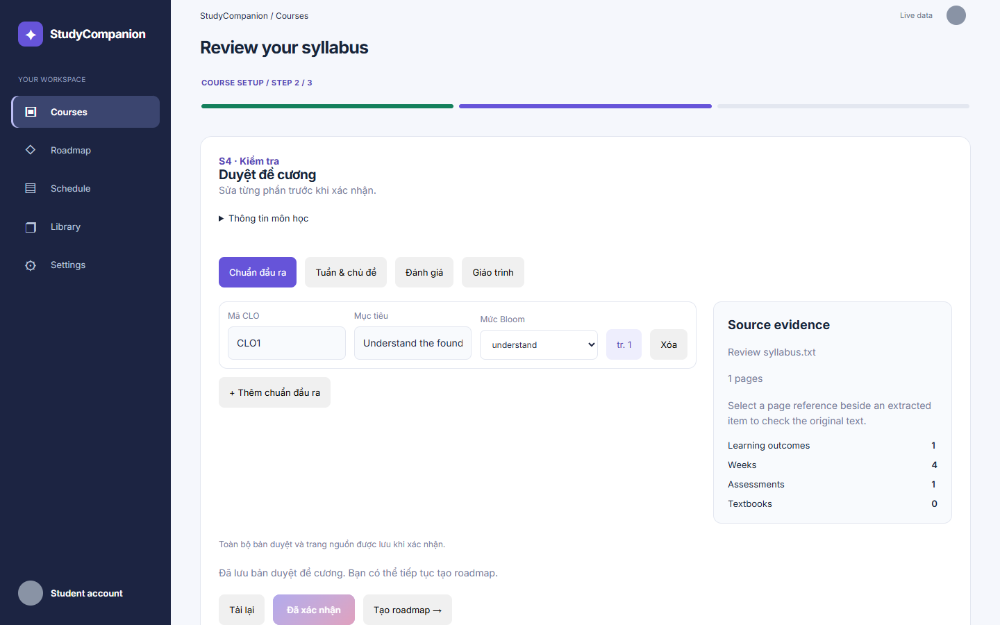

# Graph UI integration: issues #108 and #110

Local branch: `uiux-man/108-110-graph-fixes` in `D:/25125026_CS252/Group04-CS252-VirtualAssistant`.

This follow-up retains Thinh's #149 and #150 contributions. Both original PRs were merged into main under LePhanDucMan-pa before publishing these integration fixes for review.

## Implemented

- Canvas painting reads current zoom, pan, selection, hover and cycle state. Unpinned positions reset when changing layout; saved pins remain.
- Pointer capture supports node dragging, touch panning and pinch zoom. Selection happens after a click, not during dragging. Keyboard node controls focus/center a checkpoint.
- Edge hover displays metadata. Cycle validation uses the full graph even with filters active, prevents a client-side cycle request and renders the cycle in red. Structured server 409 paths are retained.
- Full/local graph responses normalize server field names, task statuses, CLO identifiers and source counts. Covers edges retain their server direction and metadata.
- Graph layout positions load/save through authenticated APIs, saves serialize, failures have a retry control, and old-course save responses cannot affect current-course status.
- Approved-roadmap edge controls add/remove through the existing APIs. Draft review retains its staged-edit behavior.
- CLO and verified-source filters use real graph metadata. Private uploads are excluded from the verified catalog-source count. Unknown source totals default to zero.
- List ordering honors prerequisites, including through hidden intermediate nodes. Search suggestions support keyboard selection. The node panel provides a local-graph action; closing it retains the center node.
- Query parameters restore filters, selected node, layout, view and roadmap without replacing the application route hash. Demo preview persistence remains session storage, explicitly separate from server persistence.
- Filter labels and duration hints meet contrast checks in the tested list/filter region. Axe is a development-only dependency.

## Verification

- `python dev.py devops ci`: 719 backend tests passed, Ruff passed, secret scan passed, benchmark fixtures validated. A pre-existing Windows checkout line-ending mismatch in `institutions.csv` was repaired locally to match Git exactly; it introduces no committed CSV change.

- `pnpm --dir ui exec vitest run --maxWorkers=2`: 201 tests passed across 36 files.
- `PLAYWRIGHT_CHANNEL=chrome pnpm --dir ui test:e2e`: 48 passed, 6 intentionally skipped. Skips cover desktop-only drag, mobile-only touch, and separately run opt-in benchmarks.
- Desktop/mobile browser checks cover search to panel, milestone coverage and prerequisites, CLO/verified filters, URL restoration after reload, local API calls, saved pinned positions, touch pinch, edge add/remove after reload, and scoped axe checks (no serious/critical violations).
- API browser checks use clearly identified intercepted fixtures. They verify UI/API contracts and reload state, not a production account or database. No backend code changed.
- Separate benchmark: 300 nodes, 299 prerequisite edges; week pan 50.5 FPS, force pan 54.4 FPS in local headless Chrome without CPU throttling. Force simulation pauses while background panning; canvas rendering continues each frame.
- Production build passes TypeScript and Vite. Main JS gzip: 121.88 KB versus 106.53 KB on pre-graph main `350224d` with the same installed toolchain (+15.35 KB). CSS: 16.15 KB versus 13.64 KB. No runtime dependency added.

See `ui/README.md` for the benchmark command and existing run instructions.

## Remaining checks before closing issues

- Repeat the 300-node benchmark on a representative mid-range laptop; development-machine FPS is not proof of that hardware requirement.
- Deployed-backend/browser persistence still needs a smoke test. The local authenticated API persistence smoke passed against port 8000 (offline AI): graph/local graph reads, layout PUT/GET, edge POST/GET, cycle 409 with a path, and edge DELETE/GET. The synthetic course was retained for manual review; this does not test syllabus parser quality.
- Review the actual graph visually at desktop/mobile sizes. Figma was intentionally excluded at the user's request.
- Axe coverage includes filters/list and the node panel/source dialog. Panel checks cover light/dark and 360 px mobile; this is not a whole-application accessibility audit.

PR #149 merged as `968d612`; PR #150 merged as `2c66ddc`. The older local issue #57/tutorial stash was left intact.

## Captured UI states

All screenshots use the explicit four-node API fixture, not production learner data.

## Review follow-up implemented

- Reopen the original syllabus from a saved graph and retain reviewed fields, dates, evidence pages and course ID. PUT returns to the original syllabus; generation uses that course ID. Legacy records without review metadata remain editable without inventing missing data.
- Separate verified counts from private materials, preserve pending/unknown states, and retain source metadata and verification provenance.
- Connect the full-stage source dialog, private extracted-page viewer, learning-path highlighting and course-wide scheduling. Ask/Practice controls are explicitly unavailable rather than silent no-ops.
- Keep usable sources visible in insufficient results, provide source/panel/page retries, ignore stale node loads, and show an empty filter state. An empty score breakdown does not claim seven scored criteria.
- The final targeted desktop/mobile flow and panel/source accessibility rerun passed 8 tests after control-style and contrast corrections.
- A real authenticated browser smoke test (no interception) reopened the retained synthetic Graph UI review course on the local API, restored its syllabus, edited and PUT the original record, confirmed the new value via an independent GET and reopened it in the UI. Only that synthetic test syllabus was prepared/edited. This does not validate the syllabus parser or a deployed backend.

The remaining review items need separate work: discoverable account/course-to-roadmap metadata, saved-source/notes persistence, calendar move/replan-diff contracts, node-scoped Ask and Practice sessions, and the Getting Started enrollment/product exception. Nothing in this PR adds new backend deletion behavior or presents preview storage as account persistence.

The dark-theme axe scan waits for finite panel color transitions to settle. CI exposed intermediate animation colors during an immediate scan; no axe rule or severity check was removed. The complete panel/source scan passed three repeated desktop runs and three repeated mobile runs after this timing correction.
